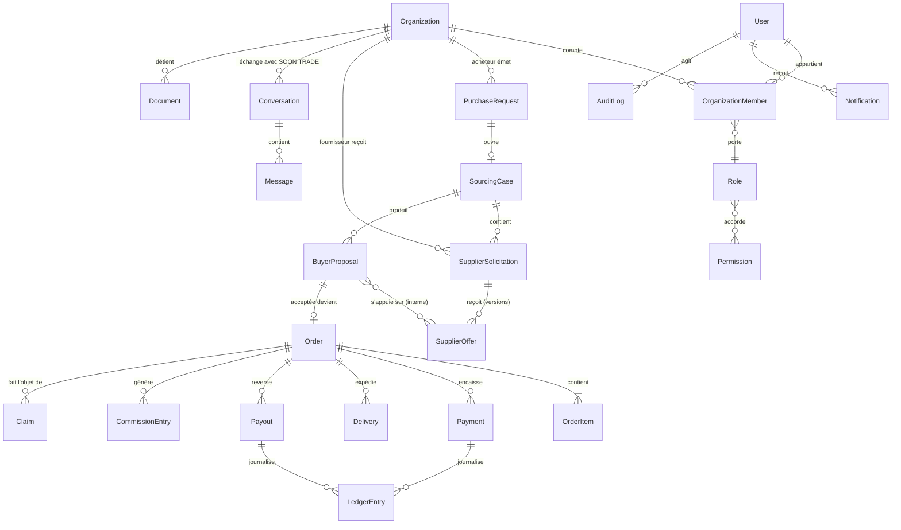

# Modèle de données initial — proposition

> **À VALIDER.** Entités reprises du README §11. Les relations et les champs clés sont
> proposés ; ils seront affinés module par module, chaque phase apportant sa migration
> Alembic.

## Conventions (DÉCIDÉES par le README)

- Clés primaires UUID, clés étrangères explicites.
- `created_at`, `updated_at` partout ; `deleted_at` (suppression logique) hors finance
  et audit, qui ne se suppriment pas.
- Montants en entiers (FCFA sans décimale) ou `NUMERIC`, jamais en flottants ; devise
  enregistrée sur chaque objet financier.
- Statuts en énumérations, transitions historisées.
- Les identifiants internes sensibles ne sortent pas dans les réponses destinées aux
  clients : références publiques lisibles (`ST-ACH-2026-084`) à la place.

## Relations

## Points de conception à retenir

**Type d'organisation.** `Organization.kind` vaut `buyer`, `supplier` ou `internal`.
C'est lui, lu en base, qui détermine l'espace accessible — jamais une valeur envoyée
par le client.

**Lien proposition ↔ offres.** Strictement interne : aucun schéma de réponse de l'espace
acheteur ne le traverse. Livré à la Phase 7 au niveau de la ligne plutôt que par une table
d'association : chaque ligne de `buyer_proposal_lines` porte `offer_id` et le prix
fournisseur au moment de la reprise (`supplier_unit_price`), ce qui donne la marge ligne
par ligne. Une proposition a des versions (`buyer_proposal_versions`), figées dès l'envoi.

**Commande figée.** `Order` porte une copie (JSON versionné) des conditions acceptées
et des lignes, de sorte qu'une modification ultérieure de la proposition ou du
catalogue ne change pas une commande passée.

**Livré à la Phase 8.** `orders.terms` (JSONB, champ `schema`) porte la copie figée ; chaque
fournisseur a son bon (`supplier_orders`, sa copie à son prix). `deliveries` appartient à
la commande et, si besoin, à un bon ; `delivery_proofs` relie une livraison à des
documents. `claims` porte l'acheteur recopié pour le cloisonnement. Seul `buyer_total`
existe pour l'instant : commission, frais et net fournisseur arrivent avec la Phase 9.

**Montants de la commande.** Colonnes distinctes : `buyer_total`, `commission_amount`,
`fees_amount`, `supplier_net`, plus le montant réellement versé porté par `Payout`.
Exemple de référence : 800 000 / 80 000 / — / 720 000 FCFA. Le calcul vit dans une
seule fonction du module finance.

**Journal financier.** `LedgerEntry` est en insertion seule : pas de `UPDATE`, pas de
`DELETE`, une correction est une écriture inverse. `PaymentWebhookEvent` porte une
contrainte d'unicité sur l'identifiant d'événement du prestataire (idempotence).

**Conversations.** Une conversation relie une organisation cliente à SOON TRADE. Il
n'existe pas de conversation entre deux organisations clientes ; la contrainte est
posée dans le schéma, pas seulement dans l'interface.

**Notes internes.** Stockées dans des tables séparées (`internal_notes`) plutôt que dans
une colonne des objets partagés, pour qu'aucune sérialisation ne puisse les emporter.

**Documents.** La base ne stocke que les métadonnées et une clé S3 non prévisible ;
l'accès passe par une URL pré-signée courte délivrée après contrôle d'autorisation.
