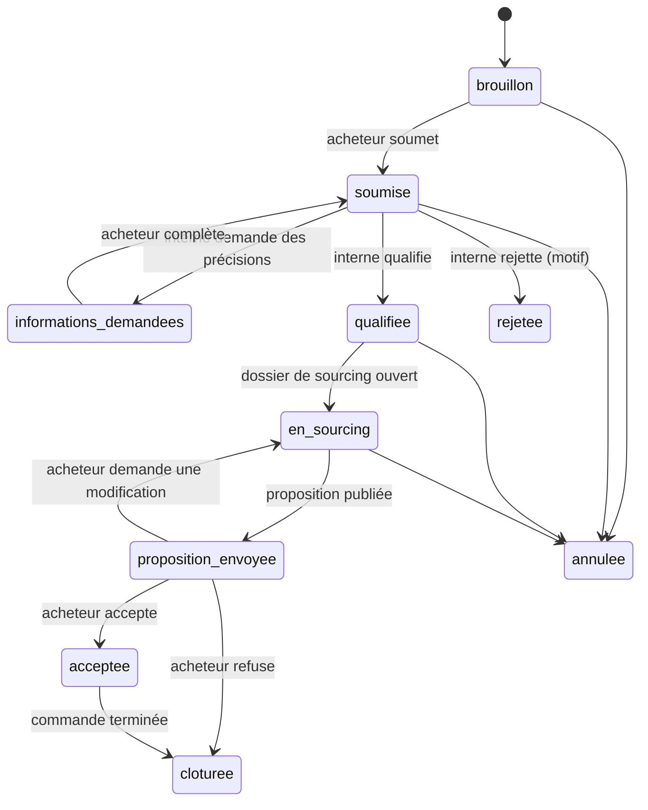
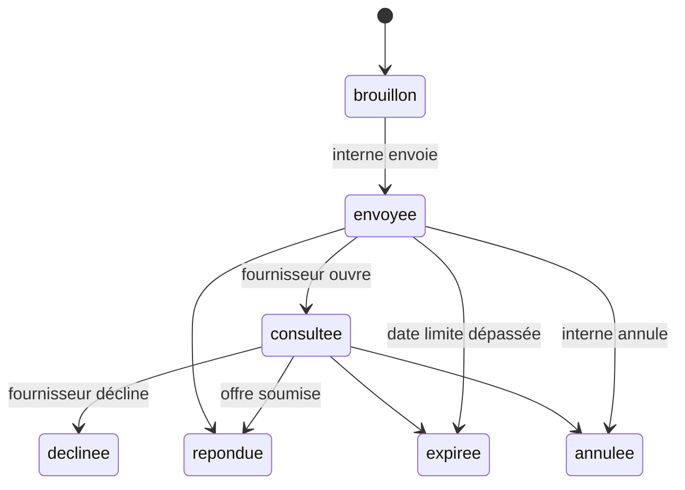
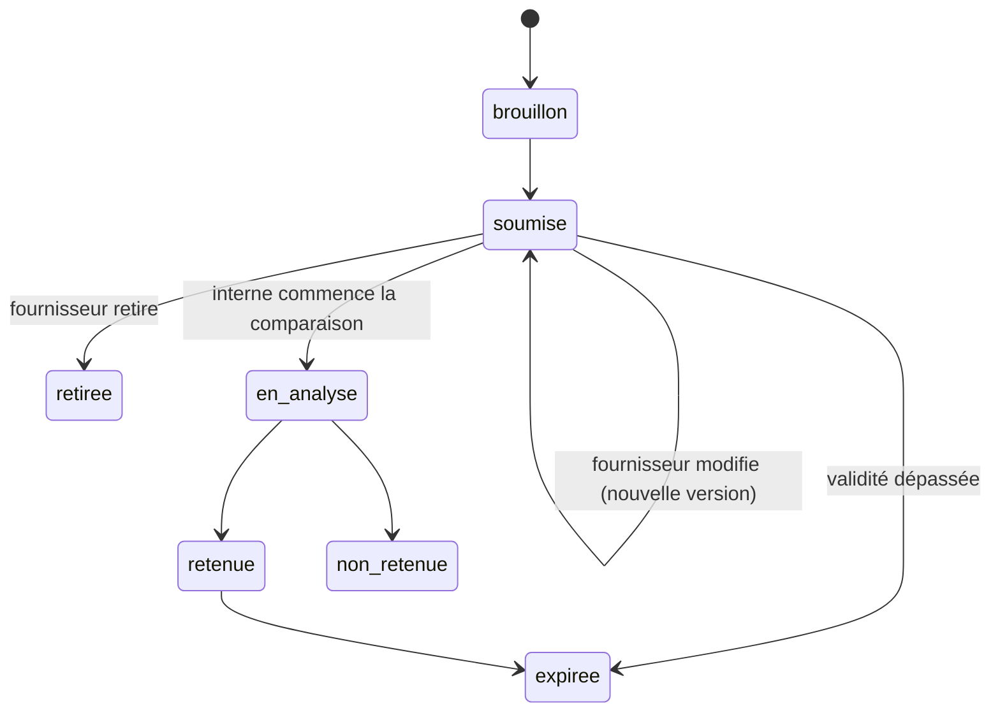
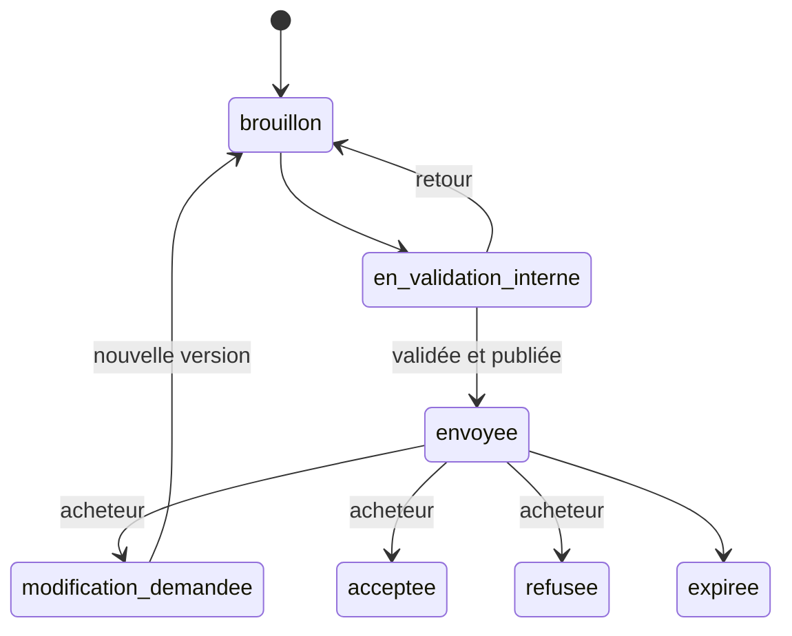
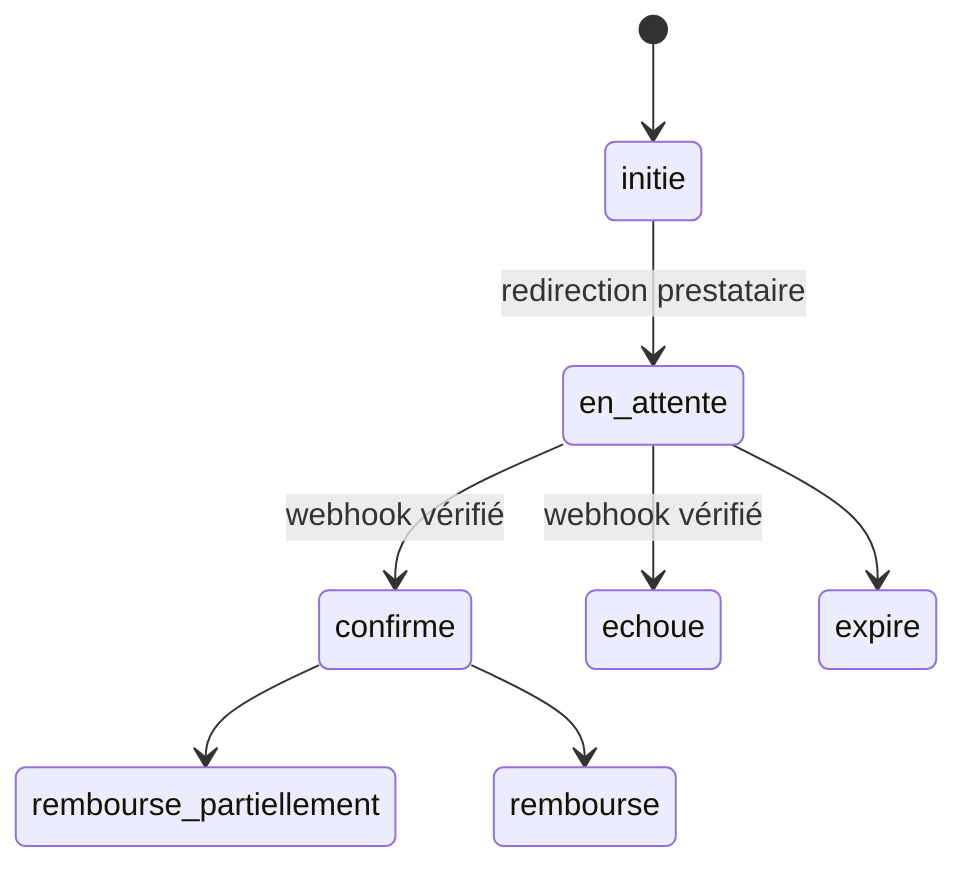

# Statuts et transitions — proposition

> **À VALIDER.** Le README classe les « statuts détaillés » parmi les points ouverts.
> Les machines ci-dessous sont une proposition dérivée du parcours en dix étapes
> (README §4). Règle impérative reprise du README : aucune transition ne contourne une
> validation interne.

Convention : chaque changement d'état est enregistré (qui, quand, depuis, vers, motif)
et n'est possible que par une action nommée, soumise à permission.

## Demande d'achat (`PurchaseRequest`)

**Choix faits à la Phase 5, à valider :**

- seuls les états brouillon, soumise, informations demandées, qualifiée, en sourcing,
  rejetée et annulée sont en service (la Phase 7 ajoute proposition envoyée, acceptée et
  clôturée) ;
- l'annulation est aussi permise depuis « informations demandées » (absente du schéma) ;
- un brouillon n'est visible que de l'acheteur ; l'équipe interne voit la demande une fois
  soumise ;
- produit, quantité, unité et lieu de livraison sont obligatoires dès le brouillon ; la
  catégorie est facultative ;
- l'acheteur voit les messages (précision demandée, motif de rejet) mais jamais le nom du
  collaborateur qui les a écrits ;
- qualifier ne porte pas de message ; l'équipe interne ne modifie pas le contenu d'une
  demande.

## Dossier de sourcing (`SourcingCase`)

**Choix faits à la Phase 5, à valider :** le dossier n'a pas encore d'état propre ; il est
modifiable tant que la demande est « en sourcing » et se fige si l'acheteur annule (les
notes restent possibles). Il est assigné par défaut à la personne qui l'ouvre et ne
s'assigne qu'à un administrateur ou un agent de sourcing. Seul un fournisseur vérifié peut
être présélectionné.

`ouvert → en_consultation → en_comparaison → proposition_preparee → clos`
(`abandonne` possible depuis tout état non clos, avec motif).

## Sollicitation fournisseur (`SupplierSolicitation`)

## Offre fournisseur (`SupplierOffer`)

Modification et retrait ne sont permis qu'à l'état `soumise` (README §5.2 : « selon son
état »). Une offre `retenue` ne peut plus être modifiée par le fournisseur.

**Choix faits à la Phase 6, à valider :**

- sollicitation : une seule par fournisseur et par dossier ; seulement pour un fournisseur
  présélectionné et vérifié ; brouillon prérempli depuis la demande (sans les
  « informations utiles » de l'acheteur) et invisible du fournisseur jusqu'à l'envoi ;
  date limite proposée à J+7, modifiable ;
- « consultée » est posé quand le fournisseur ouvre la sollicitation ; décliner est permis
  depuis « envoyée » comme « consultée » ; l'annulation interne est permise depuis
  « brouillon », « envoyée » ou « consultée », jamais après une réponse ;
- « expirée » n'est pas écrit en base : il se déduit de la date limite (sollicitation) ou
  de la date de validité (offre) ;
- offre : pas d'état « brouillon », le fournisseur envoie directement ; prix en FCFA
  (XOF) uniquement ; quantité partielle permise ; une modification crée une nouvelle
  version (contenu complet) ; une offre retirée ne peut pas être renvoyée ;
- « en analyse » expire aussi à la fin de la validité (absent du schéma) ; plusieurs
  offres peuvent être retenues dans un même dossier ;
- annuler la demande d'achat fige sollicitations et offres côté interne, mais **ne
  prévient pas** les fournisseurs déjà sollicités.

## Proposition acheteur (`BuyerProposal`)

La version acceptée est figée et copiée dans la commande.

**Choix faits à la Phase 7, à valider :**

- noms techniques : `draft`, `pending_validation`, `sent`, `changes_requested`,
  `accepted`, `refused`, `cancelled` ; « expirée » n'est pas écrit en base, il se déduit
  de la date de validité ;
- une seule proposition en cours par dossier ; une proposition annulée libère la place ;
- créée seulement s'il existe au moins une offre retenue ; préremplie avec ces offres au
  prix fournisseur (la marge reste à fixer) ; des lignes sans fournisseur (transport,
  service) sont permises ; prix en FCFA (XOF) uniquement ;
- validité proposée à J+7, et jamais au-delà de la validité des offres reprises ;
  vérifiée à la soumission et à l'envoi, comme le fait que les offres reprises sont
  toujours retenues ;
- **principe des quatre yeux** : la personne qui soumet à validation ne peut pas valider
  elle-même ; le motif d'un renvoi en préparation reste interne ;
- vendre sous le prix d'achat n'est pas bloqué : la marge négative est seulement signalée ;
- seul le propriétaire du compte acheteur accepte, refuse ou demande une modification ;
  les membres consultent ; une demande de modification exige un message, le refus non ;
- une demande de modification ou l'expiration permet de préparer une nouvelle version
  (copie de la précédente) ; l'acheteur ne voit que les versions envoyées ;
- une proposition envoyée ne s'annule pas : l'acheteur doit pouvoir décider ;
- e-mail à chaque membre actif de l'acheteur à l'envoi, sans prix ni contenu.

**Effet sur la demande d'achat :** envoi → « proposition envoyée » ; demande de
modification ou nouvelle version après expiration → « en sourcing » ; acceptation →
« acceptée » ; refus → « clôturée ». Le dossier de sourcing est figé tant que la demande
n'est pas « en sourcing ».

## Commande (`Order`)

`creee → confirmee → en_preparation → expediee → livree → cloturee`,
avec `annulee` (avant expédition) et `en_litige` (depuis `expediee` ou `livree`).

**À VALIDER :** la confirmation attend-elle le paiement intégral ?

**Choix faits à la Phase 8, à valider :**

- la commande naît **automatiquement** de l'acceptation de la proposition, dans la même
  transaction ; elle garde une copie figée (JSON versionné) de la version acceptée ;
- en attendant la Phase 9, la confirmation est **manuelle** (commercial ou administrateur)
  et n'attend aucun paiement ;
- un **bon de commande par fournisseur** (une offre reprise = un bon), à son prix d'achat,
  sans nom d'acheteur ni prix de vente ; le fournisseur ne le voit qu'une fois la commande
  confirmée ; les lignes sans fournisseur restent à SOON TRADE ;
- « en préparation » est posé par la logistique ; « expédiée » se pose seul dès qu'une
  livraison part, « livrée » dès que toutes sont arrivées ; la clôture est manuelle et
  exige que toutes les livraisons soient arrivées ;
- annulation par le commercial avec un motif lu par l'acheteur, impossible dès qu'une
  livraison est partie ; le fournisseur voit sa commande « annulée » ;
- le litige se pose seul à l'ouverture d'une réclamation sur une commande expédiée ou
  livrée, et se lève quand la dernière réclamation active reçoit une réponse ; pendant le
  litige, les livraisons continuent et c'est le statut à retrouver qui avance ; le
  fournisseur ne voit jamais le litige.

## Paiement (`Payment`)

Seul un webhook vérifié côté serveur fait passer à `confirme`. Le retour du navigateur
sur une page de succès ne change aucun état.

## Versement fournisseur (`Payout`)

`a_verser → en_validation → en_cours → verse`, avec `echoue` (retour à `a_verser`) et
`annule`.

## Livraison (`Delivery`)

`planifiee → en_preparation → en_transit → livree → confirmee`,
avec `incident` (depuis `en_transit` ou `livree`).

**Choix faits à la Phase 8, à valider :**

- planifiée par la logistique, pour la commande entière ou pour le bon d'un fournisseur,
  seulement sur une commande confirmée et pas encore livrée ; pas de suivi des quantités
  par livraison (le contenu est un texte libre) ;
- le fournisseur fait avancer la livraison de son bon (préparation, départ, arrivée) et
  renseigne transporteur et numéro de suivi ; la logistique peut tout faire ;
- seul l'acheteur confirme la réception ; un problème passe par une réclamation ;
- incident : posé par la logistique avec une note **interne** ; l'acheteur voit l'état,
  pas la note ; « reprendre » remet la livraison en route ;
- preuves (PDF, JPEG, PNG) déposées sur la livraison : celle de la logistique peut être
  publiée à l'acheteur, celle d'un fournisseur reste interne (elle peut le désigner).

## Réclamation (`Claim`)

`ouverte → en_examen → resolue | rejetee → close`.

**Choix faits à la Phase 8, à valider :**

- ouverte par l'acheteur (tout membre), de la confirmation de la commande à sa livraison,
  jamais après clôture ; motifs : quantité, qualité, retard, dommage, autre ; rattachée
  si besoin à une livraison ;
- prise en charge par la logistique ou le support ; résolution, rejet et clôture par le
  support, avec une réponse obligatoire lue par l'acheteur ; l'acheteur peut clore
  lui-même après la réponse ;
- le fournisseur n'en voit rien pour l'instant (la matrice lui donne la lecture : à
  décider avec la messagerie de la Phase 10).
