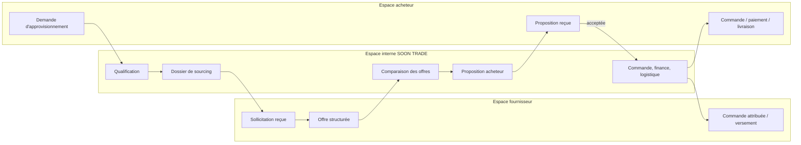

# SOON TRADE — Audit initial et cadrage (Phase 0)

> Rédigé le 14 novembre 2026 à partir de `README_SOON_TRADE.md` et des six maquettes
> présentes à la racine. Les éléments marqués **À VALIDER** ne sont pas des règles
> métier : ce sont des propositions qui attendent une décision.

## 1. État du projet à l'audit

| Élément | Constat |
|---|---|
| Code source | Aucun. Le dossier ne contenait que le README et six images. |
| Dépôt Git | Absent. Aucun dépôt distant GitHub communiqué. |
| Cahier des charges | Complet et cohérent (README, 29 sections). |
| Maquettes | 6 PNG : site public clair et sombre, tableaux de bord acheteur, fournisseur, administration, planche de marque. |
| Logo source | **Absent.** Le logo n'existe que rasterisé dans les maquettes. |
| Poste de développement | Node 22, Python 3.13, Git présents. pnpm et uv installés pendant l'audit. Démon Docker arrêté, pas de PostgreSQL local, pas de CLI GitHub. |

## 2. Synthèse de compréhension

SOON TRADE est une plateforme B2B d'**intermédiation** pour le sourcing de marchandises,
lancée à Abidjan sur le gros agroalimentaire. Ce n'est pas une marketplace : l'équipe
SOON TRADE est au centre de chaque échange. L'acheteur exprime un besoin, SOON TRADE
consulte des fournisseurs, compare leurs offres en interne, puis présente à l'acheteur
une proposition qui lui est propre. Acheteur et fournisseur ne se voient jamais.

Trois conséquences structurent tout le reste :

1. **Le cloisonnement est une règle serveur.** Un acheteur ne doit pas pouvoir obtenir
   l'identité d'un fournisseur, même en forgeant une requête. Chaque espace a donc ses
   propres schémas de réponse (DTO), pas un schéma commun filtré à l'affichage.
2. **Offre fournisseur et proposition acheteur sont deux objets distincts.** La
   proposition est construite par SOON TRADE à partir d'offres ; elle ne les référence
   jamais dans ce qui est renvoyé à l'acheteur.
3. **La finance est un journal, pas un CRUD.** Brut acheteur, commission, frais, net
   fournisseur et montant réellement versé sont cinq grandeurs distinctes, tracées par
   écritures immuables.

## 3. Les trois espaces et le parcours



Aucune flèche ne relie directement A et F : tout transite par I.

## 4. Lecture des maquettes

| Maquette | Ce qu'elle fixe |
|---|---|
| Planche de marque | Palette (primaire `#6C3BFF`, secondaire `#00D1FF`, accent `#FF8A00`, neutre `#0F172A`, fond `#F5F7FB`, surface `#FFFFFF`), typographies Inter / Manrope, icônes Lucide, sélecteur Light / Dark / Système. |
| Site clair / sombre | Barre de navigation (Accueil, Services, Secteurs, Processus, À propos, Se connecter), héros à deux lignes, deux boutons, quatre chiffres clés. |
| Acheteur | Barre latérale à 8 entrées avec compteurs, bandeau d'appel à l'action, 5 indicateurs, tableau des demandes, courbe des commandes, suivi d'étapes des commandes. |
| Fournisseur | Même ossature ; sollicitations avec action « Répondre », catalogue en cartes, taux de conversion, revenus. |
| Administration | 17 entrées de menu, 6 indicateurs, courbe double, répartition en anneau, frise du workflow, tableau des demandes, carte, fil d'activité. |

### Écarts entre les maquettes et le README

Les maquettes sont une référence de direction artistique ; le README dit d'adapter le
contenu au vrai workflow. Points où les deux divergent :

| Écart | Traitement retenu |
|---|---|
| Les maquettes écrivent « Espace Vendeur » ; le README dit « fournisseur ». | « Fournisseur » partout dans le code et l'interface. **À VALIDER** si « Vendeur » est voulu comme libellé commercial. |
| La maquette admin affiche le nom de l'acheteur dans le tableau des demandes : conforme (espace interne). La maquette fournisseur n'affiche jamais l'acheteur : conforme. | Rien à corriger. |
| Les bandeaux utilisent des photos (port, sacs de céréales). Le README n'interdit que les photos de **personnes**. | Bandeaux conservés ; images à fournir (voir §7). En attendant, dégradé violet sans photo. |
| Salutation avec emoji « 👋 ». Le README proscrit les emojis comme **système d'icônes**. | Emoji retiré ; icônes Lucide uniquement. |
| Chiffres du site (+500 fournisseurs, +1 200 opérations, 98 %). | Données fictives : ne pas publier sans chiffres réels. **À VALIDER.** |
| Sélecteur de thème absent des tableaux de bord. | Ajouté dans l'en-tête des trois espaces. |
| Navigation acheteur : la maquette omet Documents et Paramètres listés au README §22. | Navigation du README retenue. |

## 5. Arborescence du monorepo

Conforme au README §24, avec deux ajustements : `packages/` n'est pas créé tant
qu'aucun code n'est réellement partagé, et le contrat d'API est le schéma OpenAPI
généré par FastAPI plutôt qu'un paquet maintenu à la main.

```text
soon-trade/
├── README_SOON_TRADE.md
├── docs/{product,architecture,business-rules,security,design}/
├── frontend/          Next.js — app/{(public),(auth),buyer,supplier,internal}
├── backend/           FastAPI — app/{core,modules,integrations}, alembic/, tests/
├── infra/compose.yaml PostgreSQL + Redis pour le développement
├── .github/workflows/ci.yml
├── pnpm-workspace.yaml, package.json (un .env.example dans backend/ et frontend/)
```

## 6. Documents de cadrage associés

- [Matrice rôles / permissions](../security/roles-permissions.md)
- [Statuts et transitions](../business-rules/statuts-et-transitions.md)
- [Modèle de données initial](../architecture/modele-de-donnees.md)

## 7. Ce dont le projet a besoin

### Bloquant pour la suite

| Besoin | Pourquoi | Bloque |
|---|---|---|
| Fichier source du logo (SVG, versions claire et sombre) | Le README interdit de le réinventer ; un recadrage de maquette est trop peu défini. | Finition de la Phase 2 |
| Images des bandeaux (port, marchandises) avec droits d'usage | Les maquettes semblent générées ; il faut des fichiers exploitables. | Finition de la Phase 2 |
| Dépôt GitHub | CI, Renovate, déploiements Vercel et Render. | Fin de la Phase 1 |
| Docker Desktop démarré, ou une base Neon de développement | Vérifier la connexion PostgreSQL et lancer les migrations. | Phase 3 |

### À décider avant la phase concernée

| Sujet | Phase | Question |
|---|---|---|
| Authentification | 3 | Proposition : jeton d'accès JWT court + jeton de rafraîchissement rotatif, tous deux en cookies `HttpOnly`. À confirmer. |
| Inscription | 3 | **DÉCIDÉ** : sur invitation, pour les acheteurs comme pour les fournisseurs. Inscription libre plus tard. |
| Rôles internes | 3 | **DÉCIDÉ** : liste de la matrice rôles / permissions. |
| Documents KYC fournisseurs | 4 | Liste des pièces et processus de vérification. |
| Catégories de produits | 4 | Taxonomie de départ pour l'agroalimentaire. |
| Langues | 2–3 | **DÉCIDÉ** : français par défaut, anglais et allemand. Langue initiale choisie selon le pays du visiteur. |
| Commission | 9 | Assiette, taxes, partie supportant les frais, exceptions. |
| Paiements partiels, remboursements, versements partiels | 9 | Autorisés ou non. |
| Jèko | 9 | Contrat, accès Service Provider, tarifs, environnement de test. |
| Conservation des fonds | 9 | Validation par un juriste en Côte d'Ivoire. **La Phase 9 ne démarre pas sans elle.** |
| Domaine | 12 | Nom de domaine et sous-domaines. |
| Conservation des données | 12 | Politique légale. |

### Comptes de services à créer (au fil des phases)

GitHub (Phase 1), Neon (Phase 1–3), Resend avec domaine vérifié (Phase 3),
AWS S3 (Phase 4), Vercel et Render (préproduction), Upstash Redis (Phase 10),
Cloudflare (Phase 12), Jèko (Phase 9).

## 8. Versions vérifiées le 14 novembre 2026

Frontend (registre npm) : Next.js 16.4, React 19.3, Tailwind CSS 4.3, TypeScript 7.0,
Motion 14, Zustand 5.1, TanStack Query 5, TanStack Table 9, React Hook Form 7.92,
Zod 4.6, Recharts 3.10, next-intl 4.15, lucide-react 1.73, pnpm 12.18.

Backend : les versions exactes sont celles résolues et verrouillées dans `backend/uv.lock`.

Python 3.14 est verrouillé dans `backend/.python-version` : avec Python 3.15, PyYAML n'a pas encore de paquet précompilé pour Windows.
